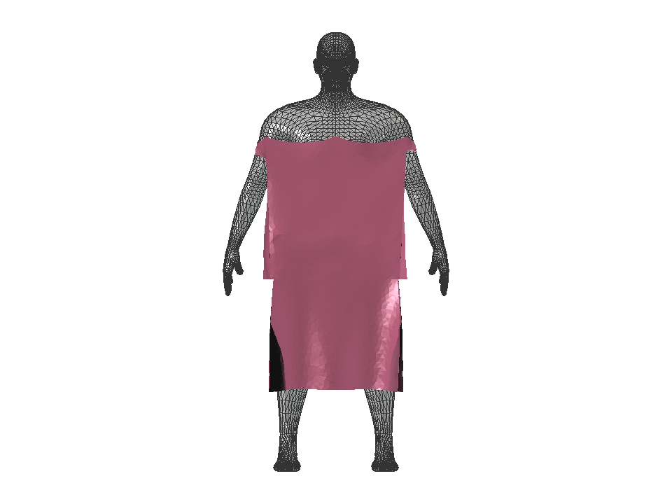

# Layered multi-garment contact test

> **Native revalidation pending.** The fixture has been rebuilt to address the box-like shirt and airborne rim supports found in [the historical run 45194827115](https://github.com/Uhrendoktor/freecad-cloth/actions/runs/45194827115). The old screenshots below remain archived as failed diagnostic evidence; they do not show the revised fixture. Do not treat them as a successful drape.

This acceptance exercises two independent garment groups on one mannequin: a shaped shirt and an A-line skirt with a separate waistband. The shirt and skirt share one simulation scene and exchange cloth-to-cloth contact, but they have no authored seam between groups.

## What changed in the fixture

The previous version made the shirt as four flat trapezoids around the mannequin and pinned twelve particles along its top rim. It also pinned twelve waistband particles. The support selector required only 5 mm of body clearance and did not limit the maximum distance, so some selected pins were nearly 100 mm from the mannequin. The screenshots from that run show a box-like torso shell and a poor final fit.

The revised fixture now follows the working two-panel tunic construction more closely:

- **Shirt:** two native Sketcher panels, front and back, with a shaped neckline, two open curved armholes, curved side ease, and semantic edge identities. Four authored seams connect the two panels. The shirt has no solver pins, matching the canonical tunic audit's free-drape configuration.
- **Skirt:** four flared panels, joined by four semantic side seams.
- **Waistband:** four panels, joined to each other and sewn to the skirt at the waist.
- **Supports:** only four waistband particles are pinned, one near each named front/right/back/left waist target. Each must be exterior to the mannequin and between **5 mm and 45 mm** from its surface. The validator checks that the four persisted support records match the four native pin indices. The shaped shirt must remain unpinned before and after save/reload.

The new fixture contains **10 Sketcher-backed PatternPieces and 16 semantic seam relationships** across two independent garment groups. The requested inter-garment clearance remains 8 mm.

## Comparison with the working tunic audit

The canonical single-tunic audit uses the same PBD gravity path, sets `PinMode="None"`, and verifies that the native solver has no pins. It uses two shaped front/back panels and simulates 90 steps at 1/240 s with four native PBD substeps.

The revised layered fixture retains the same unpinned shirt approach, but adds a four-panel skirt and waistband, with four bounded waistband supports. It runs 120 steps at 1/120 s (1.0 simulated second) with one native PBD substep. This is longer in simulated time than the former 60-step (0.5 s) layered test. It is still a finite-time diagnostic, not proof that the cloth has reached static equilibrium.

The only collision target in this fixture is the mannequin. There is **no floor collider**. The test is intended to validate a worn garment settling against the mannequin, not a loose piece of cloth falling onto a room floor.

## Revised acceptance checks

The native fixture checks all of the following:

- Ten source pattern pieces retain their Sketcher links, semantic boundaries and solver-panel mappings.
- All 16 sewing relationships produce native stitch provenance.
- The shirt's solver particle set has no intersection with the native pin set.
- The waistband has exactly four unique supports, each selected within the configured 5–45 mm stand-off range.
- Shirt and skirt remain independent garment groups.
- Contact projection leaves no measured inter-garment residual pairs at the saved checkpoints.
- Semantic seams stay within the configured gap threshold, no cloth particles are inside the mannequin, and the document rebuilds the solver correctly after save/reload.
- Nine viewport captures are produced: the initial scene, two intermediate axonometric checkpoints and six orthographic views at step 120.

These checks are necessary but not sufficient for a finished garment. In particular, the numeric minimum-clearance metric alone cannot establish close fit over the entire body. The revised screenshots still need visual inspection for body-following silhouette, natural folds and plausible skirt hang. The fixture remains a construction/contact example, not a complete production garment; sleeves, collar, cuffs, placket, size grading and calibrated woven-fabric behavior are outside its current scope.

## Historical failed screenshots

The images in this section are retained only to document the original rectangular-shell implementation from run 45194827115. They are **not** captures of the revised 10-piece fixture.

### Historical initial arrangement

### Historical step-60 orthographic views

<table>
  <tr>
    <td></td>
    <td></td>
  </tr>
  <tr>
    <td></td>
    <td></td>
  </tr>
  <tr>
    <td></td>
    <td></td>
  </tr>
</table>

The historical run did pass its focused native contact/persistence assertions, but that was a false positive for visual quality. The images are preserved for regression comparison only.

## Open the native validation artifact

The revised FreeCAD document and screenshots will be available in the **layered-outfit-acceptance** artifact attached to the current [PR #2847 validation run](https://github.com/Uhrendoktor/freecad-cloth/actions/runs/45276195963), if the native acceptance and artifact-validation jobs complete successfully.

To inspect a successful artifact, download it from the run, extract `layered-outfit/layered-outfit.FCStd`, and open it in FreeCAD. The document stores the two garment groups, Sketcher-backed pieces, semantic seams, mannequin target and support configuration; the transient native PBD state is rebuilt from those persisted properties after reopening.

For the single-garment reference path, see the [Tunic example](../EXAMPLES.md#2-tunic) and the [user guide](../USER_GUIDE.md). For implementation and review history, see [PR #2847](https://github.com/Uhrendoktor/freecad-cloth/pull/2847).
