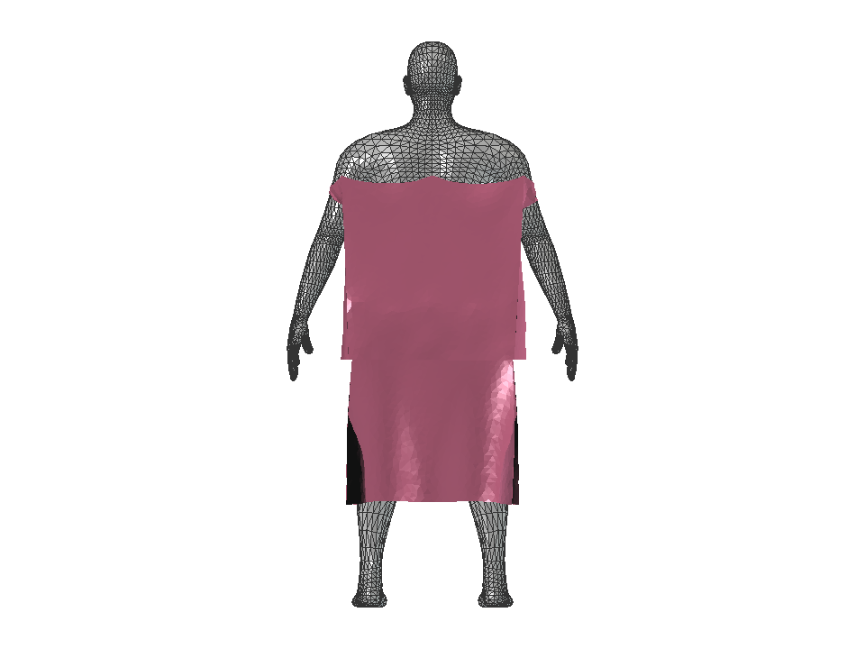
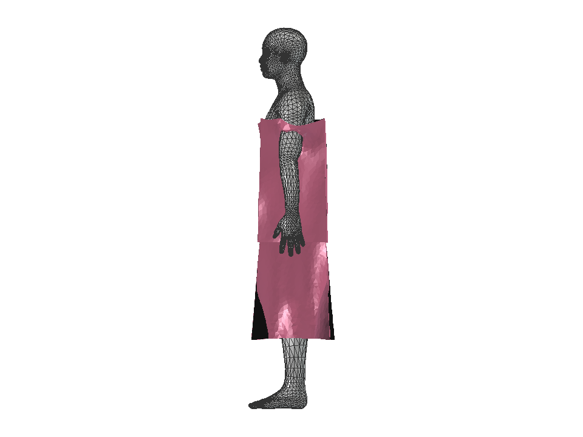

# Layered multi-garment contact test — visual review failed

> **Visual status: rejected.** The captures below are retained as diagnostic evidence from [run 45194827115](https://github.com/Uhrendoktor/freecad-cloth/actions/runs/45194827115); they are **not** an approved garment or a successful drape example. The step-0 scene is a rectangular four-sided shell, steps 1 and 15 show severe panel collapse/folding, and the step-60 views still show a straight-sided tube. Do not use these images as the expected visual result.

This example previews two garments simulated on one mannequin: a longline shirt shell and an A-line skirt with its own waistband. The important design point is that the shirt and skirt remain **independent garment groups**. They share a scene and exchange cloth-to-cloth contact, but they are not sewn to one another.

The images on this page are genuine 960 × 720 FreeCAD viewport captures from the native acceptance fixture. They are included to make the failed visual result inspectable, not to showcase the current garment design.

## Why the visual review failed

The source fixture, not the camera, is the main problem:

- `_make_ring` constructs each garment as four flat, straight-edged trapezoids arranged front/right/back/left. Their cross-section is a rectangle, so the initial scene is a box around the mannequin rather than a body-following shell.
- The top support selection checks only that a point is outside the mannequin and at least 5 mm away. It does not cap the allowed stand-off. In the run's own support audit, selected shirt anchors were about **7.9–98.8 mm** from the body and selected waistband anchors about **23.4–119.6 mm** away.
- The body-fit check records only the minimum mannequin clearance. That proves no cloth particle is inside the collision mesh; it does not prove the rest of the cloth follows the body.
- The screenshot validator checks that a PNG is nonblank. It does not detect a box-shaped silhouette, panel collapse, or implausible fit.

The native PBD solver is stepping and applying cloth-to-cloth/body constraints, but those numeric checks do not establish a good garment drape. The previous acceptance therefore passed a contact/persistence test while missing the obvious visual failure.

## Gravity, supports and the missing floor test

The fixture does pass Earth gravity to the native solver: `GravityZ = -9810 mm/s²`, with a `1/120 s` timestep. The runtime forwards that vector on every native PBD step. Therefore, the source configuration does not show gravity being disabled.

However, this is **not a free-fall test**:

- Twelve shirt particles are explicitly pinned around the shoulder boundary.
- Twelve waistband particles are explicitly pinned around the waistband's upper boundary.
- The four side panels of each ring are sewn into a closed shell.
- The only `DrapeTarget` is the mannequin. No floor plane or floor collision target is created.

The garments should therefore hang from their upper supports and drape against the mannequin; they are not expected to fall freely to the floor. Without a floor collider, unpinned cloth that falls below the mannequin would not be caught by a floor in this scene.

There is a second, more serious diagnostic gap. The first screenshot after one simulation step looks dramatically different from the arranged state. One step is only 8.33 ms; gravity alone moves a particle starting from rest by about 0.34 mm during that interval. The acceptance log records contact corrections and seam gaps, but does not record per-particle displacement before/after the native step and each collision projection. We therefore cannot yet attribute the first-frame change to gravity, body projection, inter-cloth projection, or panel-mesh publication.

The next physics diagnosis must add a controlled gravity-response test: run an unpinned representative panel from rest with gravity on and off, record its centre-of-mass and per-particle displacement after each native step, and verify that the gravity-on case moves downward at the expected scale. A separate floor-collision fixture must include an actual horizontal collision surface. Only after those controls pass should the supported mannequin drape be accepted. This distinguishes a broken gravity/integration path from the current fixture's support, collision and geometry constraints.

The next geometry pass must replace the rectangular ring with a contour-following multi-panel shell, shape the shoulder/neck/armhole boundary instead of using one horizontal top rim, and reject support points whose stand-off is too large. The visual acceptance must also test silhouette and regional body-fit gaps, not only image dimensions and pixel counts.

## What is in the scene

| Part | Construction | Group |
| --- | --- | --- |
| Shirt | Four torso-shell panels joined by four semantic side seams | **shirt** |
| Skirt | Four flared panels joined by four semantic side seams | **skirt** |
| Waistband | Four panels sewn around the waist and joined to the skirt | **skirt** |

Together, the example contains **12 Sketcher-backed PatternPieces and 16 semantic seam relationships**. The skirt and waistband form one garment assembly. The shirt is a separate garment group; no authored seam crosses between the two groups.

The shirt's upper boundary and the waistband's upper boundary are held by explicit support pins during the test. The contact test requests an 8 mm inter-garment clearance and checks the current particle/triangle geometry after projection.

## Failed initial arrangement

This is the actual step-0 source geometry. The four planar faces make the rectangular shell visible before the solver starts; this is the first sign that the authored garment envelope is not body-shaped.

## Rejected step-60 diagnostic views

The following captures show the final step-60 state. They remain here for regression diagnosis and must be replaced after the geometry and fit checks are corrected. The fixed orthographic views make front/back coverage and side/top/bottom relationships easier to inspect than a single perspective screenshot.

<table>
  <tr>
    <td></td>
    <td></td>
  </tr>
  <tr>
    <td></td>
    <td></td>
  </tr>
  <tr>
    <td></td>
    <td></td>
  </tr>
</table>

These captures show the current simulation viewport representation, including the mannequin mesh and translucent cloth surfaces. They are intended for geometry and assembly review, not as a fabric/material beauty render.

## Checkpoint results

The acceptance run measures the same scene at steps 1, 15 and 60. Contact counts are active inter-garment edge/triangle contacts; corrected-particle counts report how many particles were changed by the contact projection. A zero residual means no measured pair remains inside the requested clearance at that checkpoint.

| Step | Active contacts | Corrected particles | Residual pairs | Minimum mannequin clearance | Maximum semantic seam gap | Support-pin drift |
| ---: | ---: | ---: | ---: | ---: | ---: | ---: |
| 1 | 890 | 396 | 0 | 5.98 mm | 0.021 mm | 0.000 mm |
| 15 | 636 | 340 | 0 | 5.87 mm | 5.245 mm | 0.000 mm |
| 60 | 156 | 133 | 0 | 6.00 mm | 2.752 mm | 0.000 mm |

Across the three checkpoints, the body-containment test found no particles inside the mannequin. The measured minimum mannequin clearance stayed above 5 mm, all 24 support pins had zero drift, and the largest semantic seam gap was 5.245 mm. These are useful solver/contact diagnostics, but they are not visual-fit criteria and do not override the failed visual review above.

The contact report's residual value is a **requested-clearance deficit**, not a signed volumetric penetration depth. The acceptance checks it from current geometry after the final mannequin projection; it does not infer contact from overlapping pixels.

## Open the saved FreeCAD document

The native document is included in the **layered-outfit-acceptance** artifact for [validation run 45194827115](https://github.com/Uhrendoktor/freecad-cloth/actions/runs/45194827115).

1. Open the run page and download the **layered-outfit-acceptance** artifact.
2. Extract layered-outfit/layered-outfit.FCStd.
3. Open the FCStd file in FreeCAD.
4. Inspect the native PatternPieces, Sewing objects and Simulation scene. The scene stores the two garment groups and the requested inter-cloth clearance.

The save/reload acceptance verifies that piece links, group assignments and support-pin selections survive document reopening. The PBD runtime itself is derived state and is rebuilt from the persisted garment data after reload.

The focused layered-outfit GUI acceptance completed successfully in this run, but that pass is now considered a **false positive for visual quality**: the fixture never measured the maximum body stand-off or checked garment silhouette. The overall full-validation run was also not green. Do not treat this artifact as evidence of acceptable garment fit or as a full-repository release pass.

## Current design boundary and required redesign

This is a construction/contact feasibility example, not a finished production shirt or a complete garment-creation wizard. The shirt is a simple four-panel torso shell. It does not yet include shaped armholes, sleeves, a neckline, collar, cuffs, button placket or size grading. The fabric remains the existing generic cloth approximation; this example does not claim calibrated woven/orthotropic material behavior.

The next construction increment should change the shirt topology before adding more panels:

1. Replace the straight upper torso boundary with explicit Sketcher neckline and left/right armscye curves, retaining stable semantic edge identities.
2. Add left and right sleeve patterns whose sleeve-cap boundaries have validated semantic correspondence with the torso armscyes.
3. Add a collar stand and collar only after the neckline boundary is authoritative; add cuffs after the sleeve construction is stable.
4. Keep the shirt and skirt as separate groups, then extend the contact fixture to cover sleeve-to-torso and sleeve-to-mannequin interaction without cross-garment sewing.
5. Repeat the checkpoint, seam, pin, body-clearance, six-view and save/reload checks before describing the result as a complete outfit.

For the current end-to-end single-garment workflow, see the [Tunic example](../EXAMPLES.md#2-tunic) and the [user guide](../USER_GUIDE.md). For the implementation and test fixture, see [PR #2847](https://github.com/Uhrendoktor/freecad-cloth/pull/2847).
