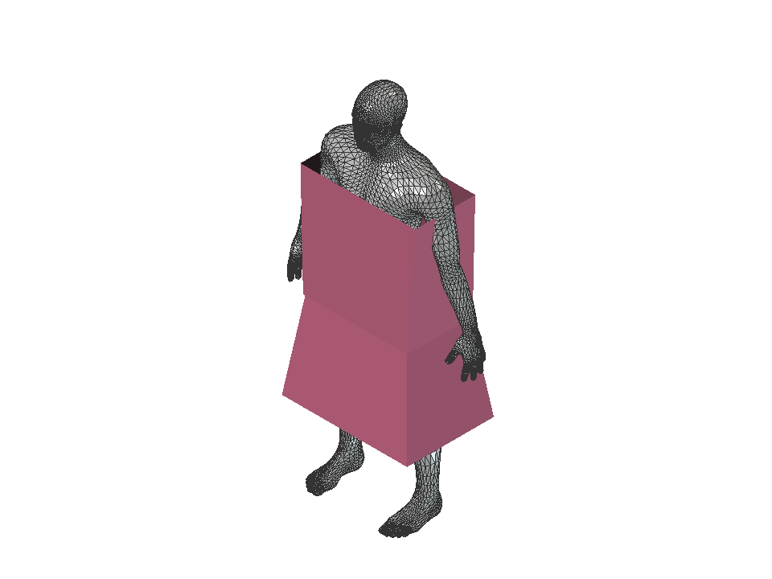
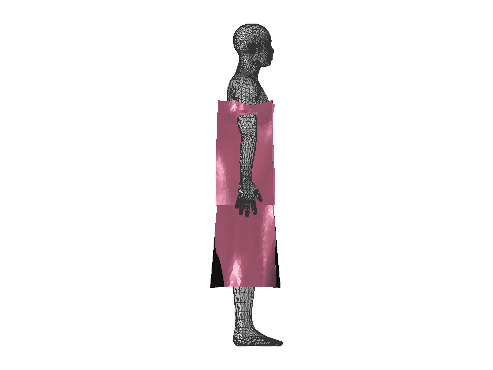
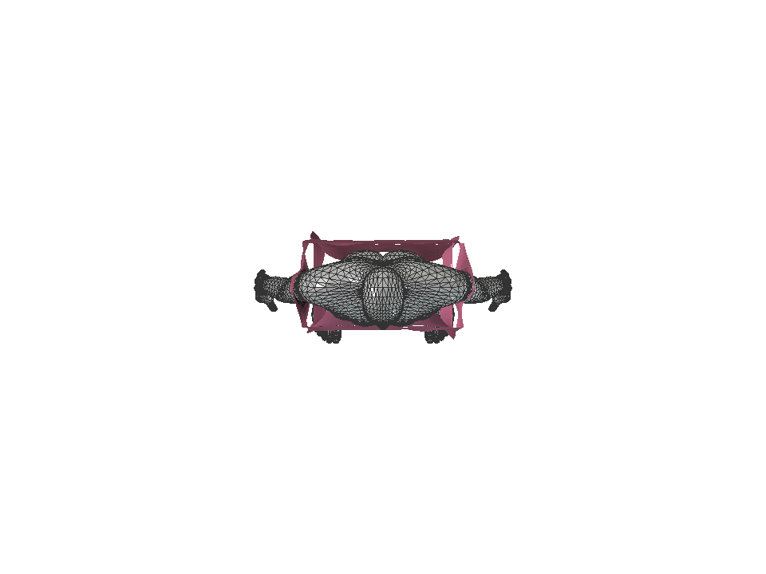
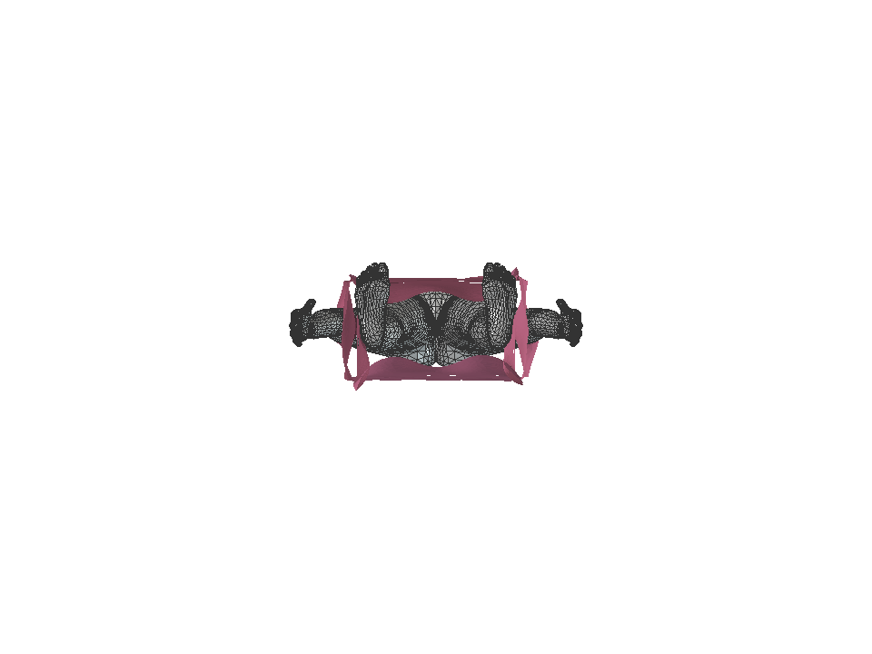

# Layered multi-garment outfit

This example previews two garments simulated on one mannequin: a longline shirt shell and an A-line skirt with its own waistband. The important design point is that the shirt and skirt remain **independent garment groups**. They share a scene and exchange cloth-to-cloth contact, but they are not sewn to one another.

The images on this page are genuine 960 × 720 FreeCAD viewport captures from the native layered-outfit acceptance fixture. They are not generated illustrations or polished product renders.

## What is in the scene

| Part | Construction | Group |
| --- | --- | --- |
| Shirt | Four torso-shell panels joined by four semantic side seams | **shirt** |
| Skirt | Four flared panels joined by four semantic side seams | **skirt** |
| Waistband | Four panels sewn around the waist and joined to the skirt | **skirt** |

Together, the example contains **12 Sketcher-backed PatternPieces and 16 semantic seam relationships**. The skirt and waistband form one garment assembly. The shirt is a separate garment group; no authored seam crosses between the two groups.

The shirt's upper boundary and the waistband's upper boundary are held by explicit support pins during the test. The contact test requests an 8 mm inter-garment clearance and checks the current particle/triangle geometry after projection.

## Initial arrangement

This is the actual arranged state before the simulation advances. The panels begin around the mannequin so the outfit contains a deliberate shirt/skirt overlap for the contact test.

## Final six-view inspection

The following captures show the final step-60 state. The fixed orthographic views make front/back coverage and side/top/bottom relationships easier to inspect than a single perspective screenshot.

<table>
  <tr>
    <td></td>
    <td></td>
  </tr>
  <tr>
    <td></td>
    <td></td>
  </tr>
  <tr>
    <td></td>
    <td></td>
  </tr>
</table>

These captures show the current simulation viewport representation, including the mannequin mesh and translucent cloth surfaces. They are intended for geometry and assembly review, not as a fabric/material beauty render.

## Checkpoint results

The acceptance run measures the same scene at steps 1, 15 and 60. Contact counts are active inter-garment edge/triangle contacts; corrected-particle counts report how many particles were changed by the contact projection. A zero residual means no measured pair remains inside the requested clearance at that checkpoint.

| Step | Active contacts | Corrected particles | Residual pairs | Minimum mannequin clearance | Maximum semantic seam gap | Support-pin drift |
| ---: | ---: | ---: | ---: | ---: | ---: | ---: |
| 1 | 890 | 396 | 0 | 5.98 mm | 0.021 mm | 0.000 mm |
| 15 | 636 | 340 | 0 | 5.87 mm | 5.245 mm | 0.000 mm |
| 60 | 156 | 133 | 0 | 6.00 mm | 2.752 mm | 0.000 mm |

Across the three checkpoints, the body-containment test found no particles inside the mannequin. The measured mannequin clearance stayed above the fixture's 5 mm minimum. All 24 explicit shirt/waistband support pins had zero drift. The largest measured semantic seam gap was 5.245 mm, below the fixture's 12 mm acceptance limit.

The contact report's residual value is a **requested-clearance deficit**, not a signed volumetric penetration depth. The acceptance checks it from current geometry after the final mannequin projection; it does not infer contact from overlapping pixels.

## Open the saved FreeCAD document

The native document is included in the **layered-outfit-acceptance** artifact for [validation run 45194827115](https://github.com/Uhrendoktor/freecad-cloth/actions/runs/45194827115).

1. Open the run page and download the **layered-outfit-acceptance** artifact.
2. Extract layered-outfit/layered-outfit.FCStd.
3. Open the FCStd file in FreeCAD.
4. Inspect the native PatternPieces, Sewing objects and Simulation scene. The scene stores the two garment groups and the requested inter-cloth clearance.

The save/reload acceptance verifies that piece links, group assignments and support-pin selections survive document reopening. The PBD runtime itself is derived state and is rebuilt from the persisted garment data after reload.

The focused layered-outfit GUI acceptance completed successfully in this run. The **overall full-validation run was not green**: separate repository checks failed in the production tunic audit and a stale timeout-count assertion. Do not treat this example artifact as a full-repository release pass.

## Current design boundary and next increment

This is a construction/contact feasibility example, not a finished production shirt or a complete garment-creation wizard. The shirt is a simple four-panel torso shell. It does not yet include shaped armholes, sleeves, a neckline, collar, cuffs, button placket or size grading. The fabric remains the existing generic cloth approximation; this example does not claim calibrated woven/orthotropic material behavior.

The next construction increment should change the shirt topology before adding more panels:

1. Replace the straight upper torso boundary with explicit Sketcher neckline and left/right armscye curves, retaining stable semantic edge identities.
2. Add left and right sleeve patterns whose sleeve-cap boundaries have validated semantic correspondence with the torso armscyes.
3. Add a collar stand and collar only after the neckline boundary is authoritative; add cuffs after the sleeve construction is stable.
4. Keep the shirt and skirt as separate groups, then extend the contact fixture to cover sleeve-to-torso and sleeve-to-mannequin interaction without cross-garment sewing.
5. Repeat the checkpoint, seam, pin, body-clearance, six-view and save/reload checks before describing the result as a complete outfit.

For the current end-to-end single-garment workflow, see the [Tunic example](../EXAMPLES.md#2-tunic) and the [user guide](../USER_GUIDE.md). For the implementation and test fixture, see [PR #2847](https://github.com/Uhrendoktor/freecad-cloth/pull/2847).
